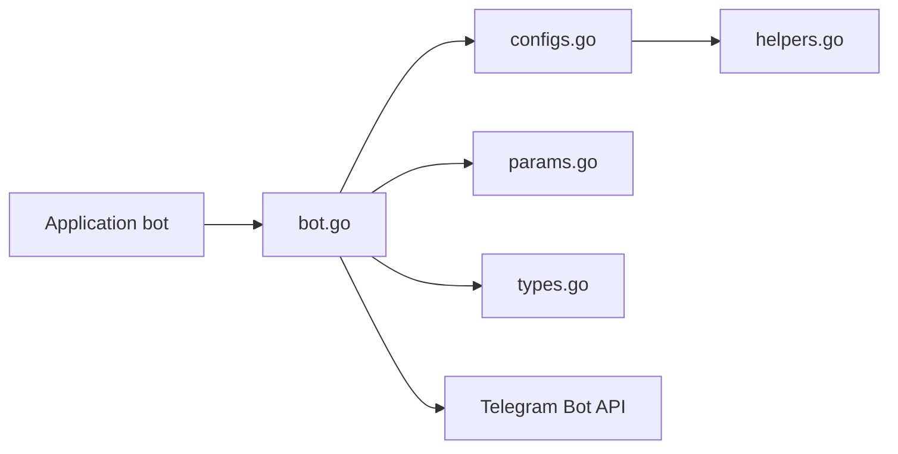

# go-telegram-bot-api/telegram-bot-api

> Go library that wraps the Telegram Bot API, for writing bots by hand.

## The problem
Talking to the Telegram API over raw HTTP forces you to handle requests, types and updates yourself.

## What it actually does
Provides a typed client: request builders, API types (including Passport), parameter encoding. Two ways to receive messages: long polling (`GetUpdatesChan`) or webhook (`ListenForWebhook`, with a TLS certificate). The scope is deliberately limited to the API wrapper, with no command framework.

## How it is wired


## Trying it
```bash
go get -u github.com/go-telegram-bot-api/telegram-bot-api/v5
```

## Cost and gotchas
Free, but you need a Telegram bot token. The webhook requires HTTPS; the README gives an openssl command for a self-signed certificate. Last push in August 2024.

## What it is not
Not a framework with plugins or command handlers: the README points to other projects without naming them.

## Alternatives
No alternative named in the README.

## For you
Keep an eye on it: only if you are coding an alert or notification bot in Go; in Python you have no use for it.
