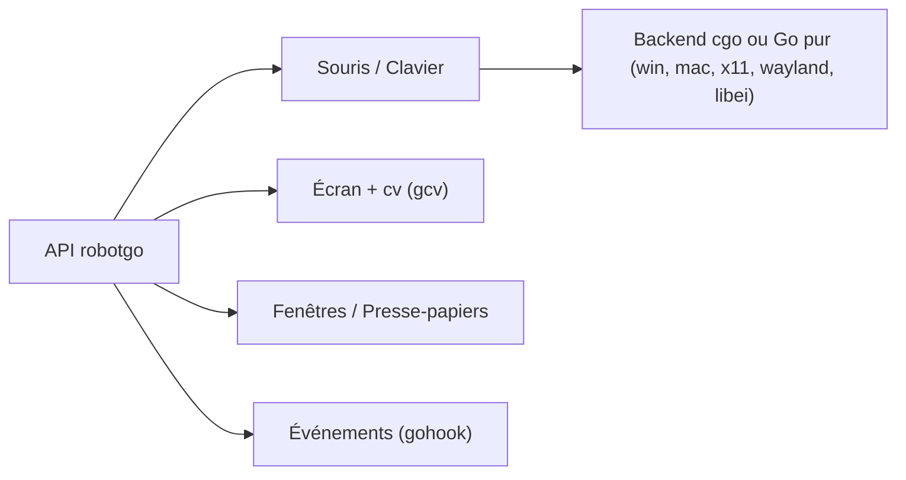

# go-vgo/robotgo

> Go library to control the mouse, keyboard, screen, windows and clipboard on Mac, Windows and Linux.

## The problem
Automating a graphical interface or testing a desktop application requires different APIs depending on the operating system.

## What it actually does
A single Go API (mouse movement and clicks, keyboard input, screen capture, pixel reading, image search via OpenCV, windows, clipboard, event listening). By default it relies on C code (GCC required); experimental pure-Go backends exist for Windows, macOS, X11, Wayland (wlroots) and libei (GNOME/KDE), selected by build tag.

## How it is wired


## Trying it
```bash
go get github.com/go-vgo/robotgo
go build -tags purego .
CGO_ENABLED=0 GOOS=linux GOARCH=amd64 go build -tags x11 .
```

## Cost and gotchas
Requires Go and GCC (MinGW on Windows); on macOS, Accessibility and Screen Recording permissions. On GNOME/KDE Wayland, the wlroots backend does not work; libei handles neither capture nor windows.

## What it is not
Not a turnkey "computer use" layer for agents despite the tagline: it is the low-level building block. The JavaScript/Python versions are reserved for RobotGo-Pro, with no open-source version.

## Alternatives
No alternative named in the README.

## For you
Worth watching: useful if you are building a computer-use agent in Go, otherwise off-topic; half of the backends are experimental and the author is a single person.
