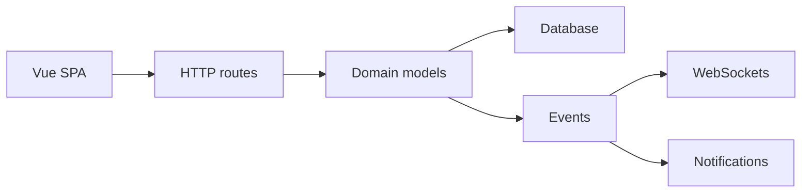

# go-vikunja/vikunja

> Self-hosted task manager, Go backend and Vue interface, for individuals and teams.

## The problem
Organizing your tasks without entrusting your data to a third-party service.

## What it actually does
Go server (REST API, WebSockets, CalDAV) with a Vue interface embedded in the binary. Projects, tasks, labels, reminders, comments, attachments, filters, webhooks. Local authentication, OpenID/OAuth, LDAP, TOTP. Import from Todoist, Trello, Microsoft To Do, TickTick, Wekan, CSV. Local or S3 storage; Electron desktop application.

## How it is wired

## Trying it
The README gives no command; it points to the website for installation and to try.vikunja.io for a demo.

## Cost and gotchas
Hosted version and Pro offering are paid (admin panel, audit logs, time tracking). AGPL-3.0 license. Part of the code is written with LLM-assisted coding tools, according to the README.

## What it is not
Not a data or AI tool: it is a general-purpose task management application.

## Alternatives
The README names no alternative.

## For you
Ignore for data/AI watch: a good product but unrelated to your field; useful only as a personal self-hosted tool.
