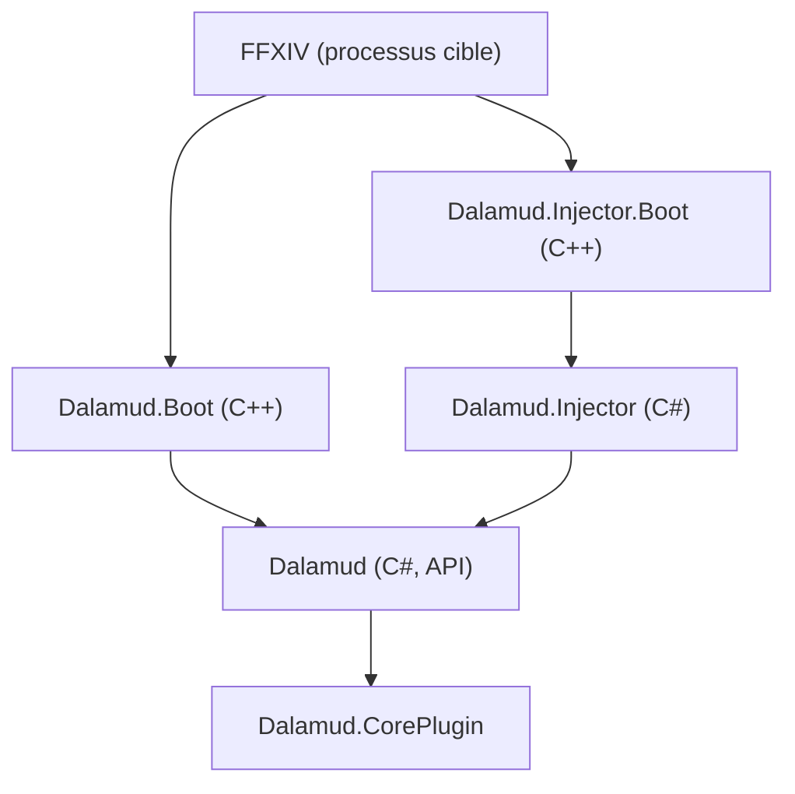

# goatcorp/Dalamud

> Plugin framework for Final Fantasy XIV that injects itself into the game, for plugin authors.

## The problem
The game offers no official interface to add modules, read its data or draw overlays.

## What it actually does
Dalamud loads into the game process through DLL injection or by rewriting the entry point. It loads the .NET runtime and exposes an API: game data, chat, overlays. A test plugin, `Dalamud.CorePlugin`, is used to prototype access to internal components. Users go through XIVLauncher, not through this repo.

## How it is wired


## Trying it
```bash
# Aucune commande dans le README : voir la page de documentation
# « building Dalamud » pour compiler.
```

## Cost and gotchas
Free, AGPL-3.0. Building requires a C++ and .NET toolchain. The project refuses contributions made with generative AI. The game belongs to Square Enix.

## What it is not
Not a tool to install in order to play: you need XIVLauncher. Injecting into a third-party process may violate the game's terms.

## Alternatives
- No alternative named in the README.

## For you
Ignore: game modding framework with no link to data, AI or MLOps.
