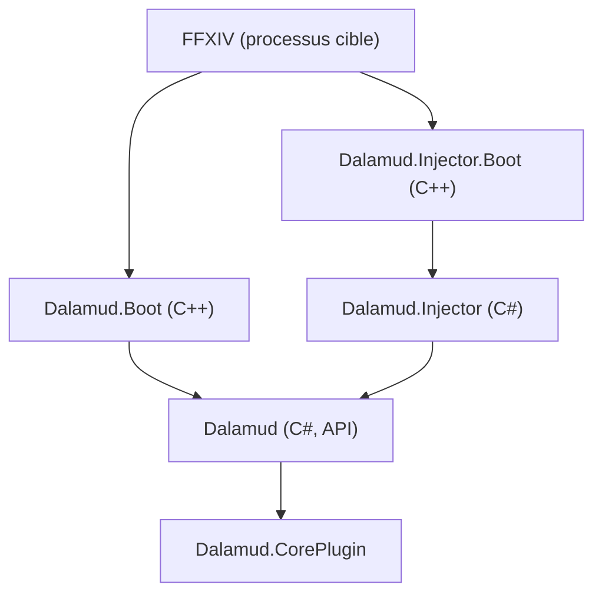

# goatcorp/Dalamud

> Cadre de plugins pour Final Fantasy XIV, qui s'injecte dans le jeu, pour auteurs de plugins.

## Le problème
Le jeu n'offre aucune interface officielle pour ajouter des modules, lire ses données ou dessiner des surcouches.

## Ce que ça fait vraiment
Dalamud se charge dans le processus du jeu par injection de DLL ou en réécrivant le point d'entrée. Il charge le runtime .NET et expose une API : données du jeu, chat, surcouches. Un plugin de test, `Dalamud.CorePlugin`, sert à prototyper l'accès aux composants internes. Les utilisateurs passent par XIVLauncher, pas par ce dépôt.

## Comment c'est branché


## Essayer
```bash
# Aucune commande dans le README : voir la page de documentation
# « building Dalamud » pour compiler.
```

## Coût et pièges
Gratuit, AGPL-3.0. Compilation avec chaîne C++ et .NET. Le projet refuse les contributions faites avec une IA générative. Le jeu appartient à Square Enix.

## Ce que ce n'est pas
Pas un outil à installer pour jouer : il faut XIVLauncher. L'injection dans un processus tiers peut contrevenir aux conditions du jeu.

## Alternatives
- Aucune alternative nommée dans le README.

## Pour toi
À ignorer : cadre de modding de jeu sans lien avec data, IA ou MLOps.

