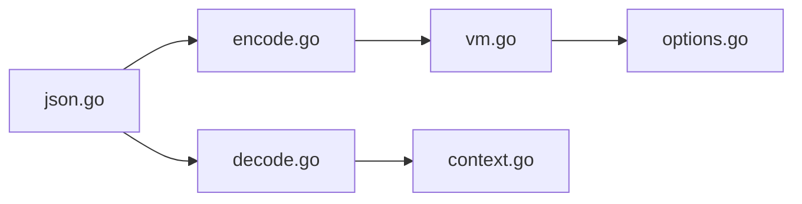

# goccy/go-json

> Go JSON encoder and decoder, compatible with encoding/json, advertised as faster.

## The problem
`encoding/json` is slow on heavy workloads and the alternatives break compatibility.

## What it actually does
Drop-in replacement by simply changing the import. Techniques described: buffer reuse, removing reflection via `typeptr`, encoding through an opcode sequence, bitmaps for field lookup when decoding. Options: propagated context, typed field filtering, colored output. The benchmark figures are not in the text that was read.

## How it is wired


## Trying it
```
go get github.com/goccy/go-json
```
```
-import "encoding/json"
+import "github.com/goccy/go-json"
```

## Cost and gotchas
Free. Relies on `unsafe`; the NoEscape variant is optional because of a Go compiler bug. 173 open issues.

## What it is not
Not guaranteed to be identical to encoding/json on every edge case: test before switching.

## Alternatives
json-iterator/go, segmentio/encoding/json, easyjson, gojay, simdjson-go (comparison table in the README).

## For you
Possible gain on Go services with heavy JSON volume; measure first: watch.
