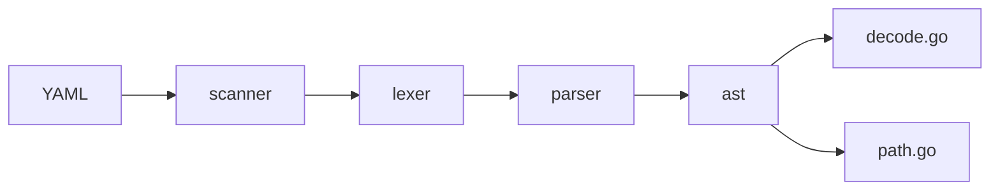

# goccy/go-yaml

> YAML library for Go written from scratch, an alternative to go-yaml/yaml.

## The problem
The reference library go-yaml/yaml is poorly maintained, does not parse all of YAML and produces hard-to-read errors.

## What it actually does
Reflection-based Marshal/Unmarshal with `yaml` or `json` tags, with no dependencies. Adds an exposed tokenizer and parser, an AST that preserves comments, anchors and aliases, YAMLPath queries, errors formatted with position and color, validation via go-playground/validator and resolution of anchors from other files. According to the README, it passes about 60 more cases than `yaml.v3` from the official test suite (as of 2024-12-15).

## How it is wired


## Trying it
```bash
go get github.com/goccy/go-yaml
git clone https://github.com/goccy/go-yaml.git
cd go-yaml/cmd/ycat && go install .
```

## Cost and gotchas
Free. 223 open issues. Tests with external dependencies go in `testdata`.

## What it is not
Not a fork of go-yaml/yaml: the README stresses that there is no relation. The `Bytes` marshalers are slower than the `Interface` ones.

## Alternatives
The README cites go-yaml/yaml, ghodss/yaml and sigs.k8s.io/yaml (to be avoided according to it).

## For you
Ignore unless you have a Go project: a good library for reading YAML configs, but purely Go.
