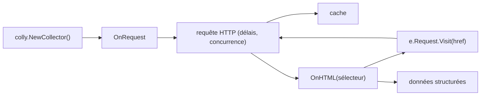

# gocolly/colly

> Go crawling framework for extracting structured data from websites.

## The problem
Writing a crawler by hand means handling cookies, delays, concurrency and encodings yourself.
Without per-domain limits, a naive scraper gets banned within minutes.

## What it actually does
A `Collector` declares callbacks: `OnHTML` on a CSS selector, `OnRequest` before each request.
Automatically handles cookies and sessions, delays between requests and maximum concurrency per domain.
Synchronous, asynchronous and parallel modes; response caching; automatic encoding of non-unicode responses.
Support for `robots.txt`, distributed scraping, configuration through environment variables, an extension system.

## How it is wired


## Trying it
```bash
go get github.com/gocolly/colly/v2
```

## Cost and gotchas
Free as software; the README pushes two paid services (NodeMaven for proxies, SerpApi for search) with promo codes.
Advertised at over 1,000 requests per second on a single core: that is also a good way to get blocked.

## What it is not
It is not a browser: no JavaScript is executed, so there is nothing to extract from a client-side rendered page.
It is not legal protection: respecting `robots.txt` is an option, not a guarantee of compliance.
The support channel given (`#colly` on freenode) no longer exists in that form.

## Alternatives
No alternative named in the README; only a list of projects that use it.

## For you
The right tool if your data collection targets static HTML and you accept writing Go.
