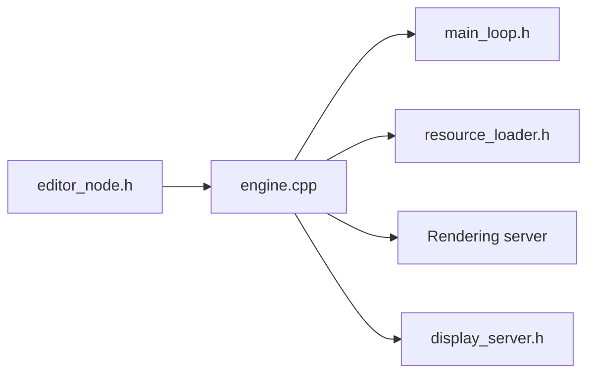

# godotengine/godot

> Cross-platform 2D and 3D game engine with an integrated editor, for game creators.

## The problem
Making a game means rewriting rendering, physics, editor and export for every platform.

## What it actually does
A single editor for 2D and 3D scenes, animation and debugging, a runtime engine, a rendering server (OpenGL or RenderingDevice), a resource system and one-click export to desktop, mobile, web and consoles. The precise internal links are not detailed.

## How it is wired


## Trying it
```bash
# aucune commande documentée : binaires sur le site officiel, compilation selon la documentation
```

## Cost and gotchas
Free, MIT. No dependency on a service. Building from source follows the official documentation.

## What it is not
Not a simulation or AI tool: a game engine. 18,907 open issues show a very active project.

## Alternatives
No alternative named in the README.

## For you
Ignore for a data, AI or MLOps profile, unless you need visual simulation: the subject is video games.
