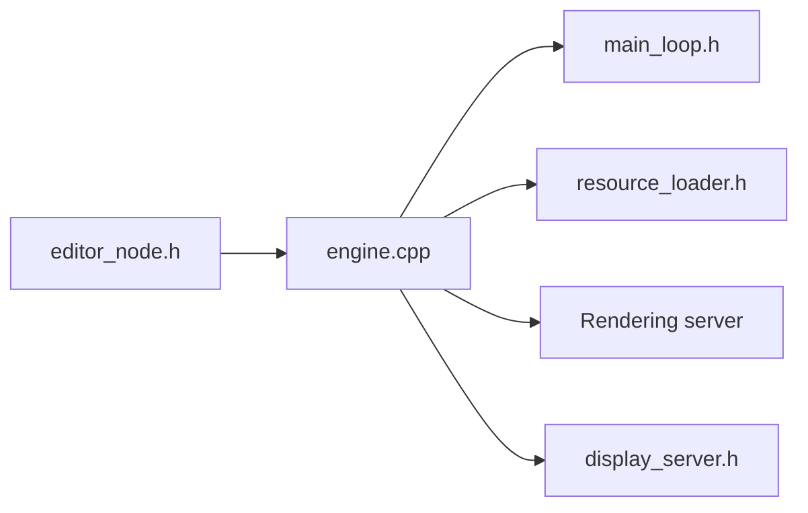

# godotengine/godot

> Moteur de jeu 2D et 3D multiplateforme avec éditeur intégré, pour créateurs de jeux.

## Le problème
Créer un jeu oblige à réécrire rendu, physique, éditeur et export pour chaque plateforme.

## Ce que ça fait vraiment
Un éditeur unique pour scènes 2D et 3D, animation et débogage, un moteur d'exécution, un serveur de rendu (OpenGL ou RenderingDevice), un système de ressources et l'export en un clic vers desktop, mobile, web et consoles. Les liens internes précis ne sont pas détaillés.

## Comment c'est branché


## Essayer
```bash
# aucune commande documentée : binaires sur le site officiel, compilation selon la documentation
```

## Coût et pièges
Gratuit, MIT. Pas de dépendance à un service. La compilation depuis les sources suit la documentation officielle.

## Ce que ce n'est pas
Pas un outil de simulation ou d'IA : un moteur de jeu. 18 907 issues ouvertes montrent un projet très actif.

## Alternatives
Aucune alternative nommée dans le README.

## Pour toi
À ignorer pour un profil data, IA ou MLOps, sauf besoin de simulation visuelle : le sujet est le jeu vidéo.

