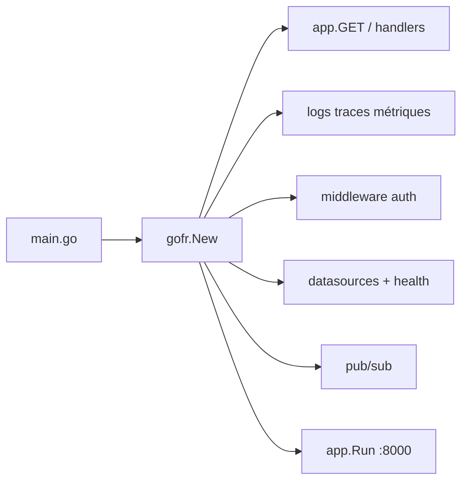

# gofr-dev/gofr

> Opinionated Go framework for writing microservices deployed on Kubernetes with built-in observability.

## The problem
Every Go microservice redoes the same layers: config, logs, traces, metrics, health, migrations.
The business code ends up drowned in this plumbing repeated from one service to the next.

## What it actually does
Provides a short HTTP API (`app.GET`, `app.Run()`) that serves on `localhost:8000` by default.
Embeds logs, traces and metrics, plus authentication middlewares and custom middlewares.
Covers gRPC, pub/sub, websockets, cron, database migrations and Swagger rendering.
Adds a health check on all data sources and log level changes without a restart.

## How it is wired


## Trying it
```bash
go get -u gofr.dev/pkg/gofr
go run main.go
```
The service then answers on `localhost:8000/greet`. Cloning: `git clone https://github.com/gofr-dev/gofr.git`.

## Cost and gotchas
Requires Go 1.26 or later. The framework is described as Kubernetes-oriented: outside that context, some
of the choices (health, config, observability) will be imposed on you without serving you.

## What it is not
Not a neutral library: the README presents it as opinionated, you adopt its conventions.
Not a data tool: it is a web service foundation, not stream processing.
Not a foundation project: the repository is listed in the CNCF Landscape, which is not CNCF governance.

## Alternatives
None named in the README.

## For you
Off-topic for a data/MLOps profile, unless your team already writes its services in Go.
