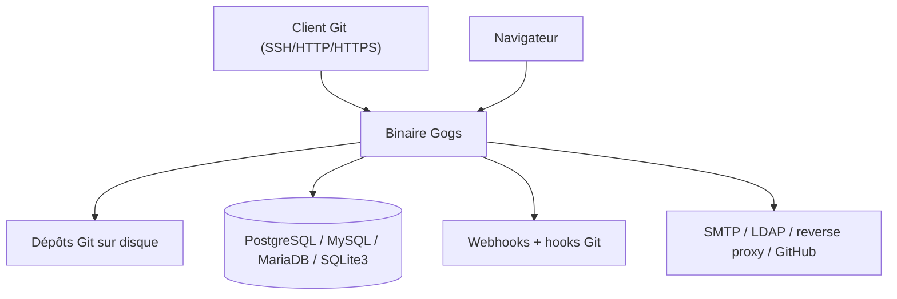

# gogs/gogs

> Self-hosted Git forge in Go, single binary, for those who want their own private GitHub.

## The problem
Without it, hosting your own Git requires a heavy stack (database, runtime, reverse proxy) or
accepting a third-party service for code you do not want to expose.

## What it actually does
Serves repositories over SSH, HTTP and HTTPS, with issues, pull requests, wiki and protected branches.
Manages users, organizations, webhooks (Slack, Discord, Dingtalk), Git hooks, deploy keys
and Git LFS. Migrates or mirrors repositories from other forges, wiki included.
Renders Jupyter notebooks and PDFs, and authenticates via SMTP, LDAP, reverse proxy or GitHub with 2FA.

## How it is wired


## Trying it
```bash
# Aucune commande d'installation dans le README : il renvoie à la documentation
# et à des déploiements Cloudron, YunoHost, alwaysdata.
```

## Cost and gotchas
Free, nothing to pay. The README says a Raspberry Pi or a $5 droplet is enough,
2 cores and 512 MB of RAM for a team. An external database is to be planned for anything other than SQLite.

## What it is not
It is not a full GitHub: no built-in CI described, and the API is explicitly
"experimental". Nor is it a managed service: backup, updates
and network exposure remain your responsibility.

## Alternatives
No alternative named in the README.

## For you
Useful if you want to keep your notebook and pipeline repos in-house without maintaining GitLab.
