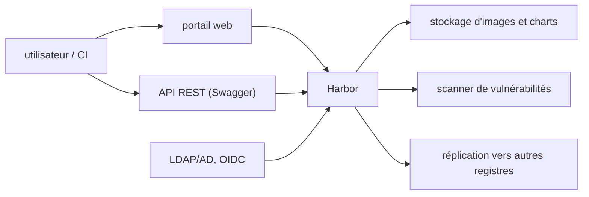

# goharbor/harbor

> Self-hosted image and chart registry, with vulnerability scanning and access control.

## The problem
A public registry gives no fine-grained access control, no audit, and no systematic image scanning.
Pulling images from a distant registry slows builds and deployments.

## What it actually does
Extends Docker Distribution: container images and Helm charts, organized into "projects" with role-based permissions.
Replicates images between registries according to filtered policies (repository, tag, label), with error recovery.
Regularly scans images and can block deployment of a vulnerable image.
LDAP/AD, OIDC with SSO, garbage collection, REST API with embedded Swagger, audit log.

## How it is wired


## Trying it
```bash
brew install sigstore/tap/cosign
cosign verify-blob \
  --bundle harbor-offline-installer-v2.15.0.tgz.sigstore.json \
  --certificate-oidc-issuer https://token.actions.githubusercontent.com \
  --certificate-identity-regexp '^https://github.com/goharbor/harbor/.github/workflows/publish_release.yml@refs/tags/v.*$' \
  harbor-offline-installer-v2.15.0.tgz
```

## Cost and gotchas
On Linux: docker 20.10.10-ce+ and docker-compose 1.18.0+; on Kubernetes, use the Harbor chart.
The `main` branch may be unstable: install only from releases.

## What it is not
It is not a managed service: it is infrastructure you must operate, back up and update.
It is not an in-house scanner: Harbor plugs in third-party scanner adapters.
The last external security audit cited dates from October 2019 (Cure53).

## Alternatives
Docker Distribution: the bare registry that Harbor extends, if you need neither permissions nor scanning.

## For you
Relevant only if you self-host your model images; otherwise a cloud registry is enough.
