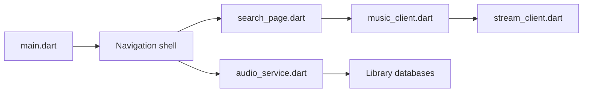

# gokadzev/Musify

> Android music streaming app with no ads or subscription, based on external sources.

## The problem
Listening to music online without a paid account or advertising.

## What it actually does
A Flutter/Dart app: search, playback, offline listening, playlists, radios, lyrics, Spotify import, equalizer, SponsorBlock, 21 languages. According to the code, streams go through embedded YouTube Music/YouTube clients (`youtube_explode_dart`), and therefore depend on a third-party service.

## How it is wired

## Trying it
No command documented in the README (Download section with no readable link).

## Cost and gotchas
Free. Depends on YouTube protocols that are prone to breaking. The disclaimer shifts legal responsibility to the user.

## What it is not
Not a service hosting content: it accesses external sources; copyright risks.

## Alternatives
No alternative named in the README (the original Musify is cited as inspiration).

## For you
Ignore: mobile streaming app, legal risk, unrelated to your field.
