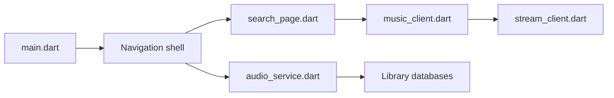

# gokadzev/Musify

> Application Android de streaming musical sans pub ni abonnement, basée sur des sources externes.

## Le problème
Écouter de la musique en ligne sans compte payant ni publicité.

## Ce que ça fait vraiment
Appli Flutter/Dart : recherche, lecture, écoute hors ligne, playlists, radios, paroles, import Spotify, égaliseur, SponsorBlock, 21 langues. D'après le code, les flux passent par des clients YouTube Music/YouTube embarqués (`youtube_explode_dart`), donc dépendants d'un service tiers.

## Comment c'est branché

## Essayer
Aucune commande documentée dans le README (section Download sans lien lisible).

## Coût et pièges
Gratuit. Dépendance à des protocoles YouTube sujets à rupture. Le disclaimer renvoie la responsabilité légale à l'utilisateur.

## Ce que ce n'est pas
Pas un service hébergeant du contenu : il accède à des sources externes ; risques de droits d'auteur.

## Alternatives
Aucune alternative nommée dans le README (Musify original cité comme inspiration).

## Pour toi
À ignorer : application mobile de streaming, risque juridique, sans lien avec ton métier.

