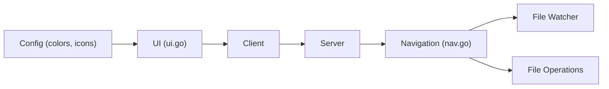

# gokcehan/lf

> Terminal file manager written in Go, inspired by ranger, for shell users.

## The problem
Navigating and manipulating files in a terminal with basic commands is slow; heavier managers come with dependencies.

## What it actually does
Static binary with no runtime dependency, cross-platform. Asynchronous I/O, client/server architecture to drive several instances, vi or readline key bindings, configuration through shell commands. Deliberately offers no tabs, no built-in pager or editor, and no file commands of its own.

## How it is wired


## Trying it
```bash
env CGO_ENABLED=0 go install -trimpath -ldflags="-s -w" github.com/gokcehan/lf@latest
lf
lf -help
lf -doc
```

## Cost and gotchas
Free. Building requires Go; otherwise community binaries and packages exist. Few native integrations: you have to write them in the configuration.

## What it is not
Not a graphical explorer: no tabs and no file operations of its own, everything goes through shell tools.

## Alternatives
ranger, cited as a source of inspiration.

## For you
Watch: pleasant for browsing datasets on a server over SSH, but it is only a convenience, not a tool of your trade.
