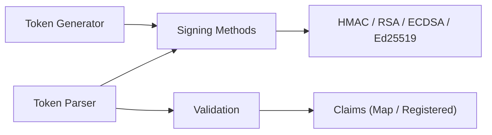

# golang-jwt/jwt

> Go implementation of JSON Web Tokens to sign, parse and verify authentication tokens.

## The problem
Handling JWTs by hand is risky: wrong algorithm verification, unsigned tokens accepted by mistake.

## What it actually does
Creates, signs, parses and validates JWTs. HMAC SHA, RSA, RSA-PSS, ECDSA signatures (and Ed25519 according to the architecture described). `alg=none` tokens are only accepted with the `UnsafeAllowNoneSignatureType` constant. Extension points: `SigningMethod` and `Keyfunc`, which allow cloud KMS, HSM or JWKS through third-party extensions. A `cmd/jwt` utility helps with debugging.

## How it is wired


## Trying it
```sh
go get -u github.com/golang-jwt/jwt/v5
```
```go
import "github.com/golang-jwt/jwt/v5"
```

## Cost and gotchas
Free. You must check yourself that the algorithm presented is the expected one. v5 is not fully backward compatible: a migration guide exists.

## What it is not
It is not a complete authentication system: no user management, no sessions, no OAuth.

## Alternatives
No alternative named in the README.

## For you
Adopt it if you write Go services (model APIs, gateways) that verify tokens: de facto standard, MIT, actively maintained.
