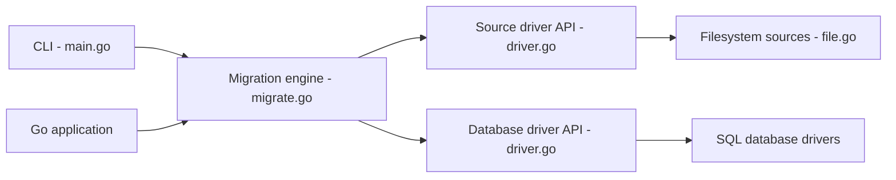

# golang-migrate/migrate

> Go tool and library for versioned database migrations, as a CLI or imported.

## The problem
Evolving a database schema in an ordered, reversible and reproducible way across environments.

## What it actually does
Reads `up`/`down` migrations from sources (file system, `io/fs`, GitHub, GitLab, Bitbucket, S3, GCS) and applies them in order through a database driver (PostgreSQL, MySQL, SQLite, MongoDB, ClickHouse, CockroachDB, Cassandra, SQL Server…). Clean `GracefulStop`, with no leaking goroutine. Drivers are deliberately "dumb": when in doubt, fail.

## How it is wired


## Trying it
```bash
migrate -source file://path/to/migrations -database postgres://localhost:5432/database up 2
docker run -v {{ migration dir }}:/migrations --network host migrate/migrate -path=/migrations/ -database postgres://localhost:5432/database up 2
```

## Cost and gotchas
Free. Reserved characters in the connection URL must be escaped. v3 is no longer supported; use v4.

## What it is not
Not an ORM nor a migration generator: the SQL files are yours to write. Some drivers are marked "todo". License not identified by GitHub.

## Alternatives
- migradaptor: to come from another tool, not affiliated with the project.

## For you
Adopt it to version the schema of your application or ML metadata databases (up/down files, CI): simple and multi-database.
