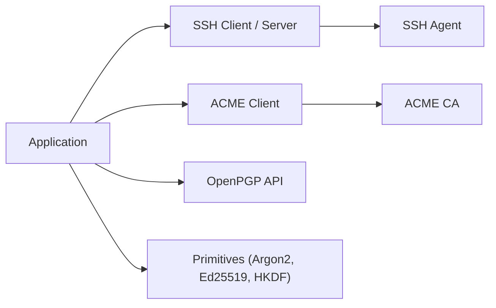

# golang/crypto

> Go's supplementary cryptography packages: SSH, ACME, OpenPGP, key derivation, primitives.

## The problem
Go's standard library does not cover all the common cryptographic protocols and primitives.

## What it actually does
Minimal README (under 800 characters): it mostly explains how to contribute through Gerrit. According to the architecture: SSH clients and servers, SSH agent, ACME client, OpenPGP, OTR, Argon2, ChaCha20-Poly1305, Ed25519, Curve25519, HKDF and trust roots.

## How it is wired

## Trying it
No commands in the README. The README only gives the Git repository `https://go.googlesource.com/crypto` and issue tracking at go.dev/issues.

## Cost and gotchas
Free. Contributions go through Gerrit, with heightened review, so it is slow.

## What it is not
Not a product. Not to be confused with the standard library `crypto`.

## Alternatives
No alternative named in the README.

## For you
Adopt it if you write Go: it is the official source, maintained by the Go team. Minimal entry, since the README is very short.
