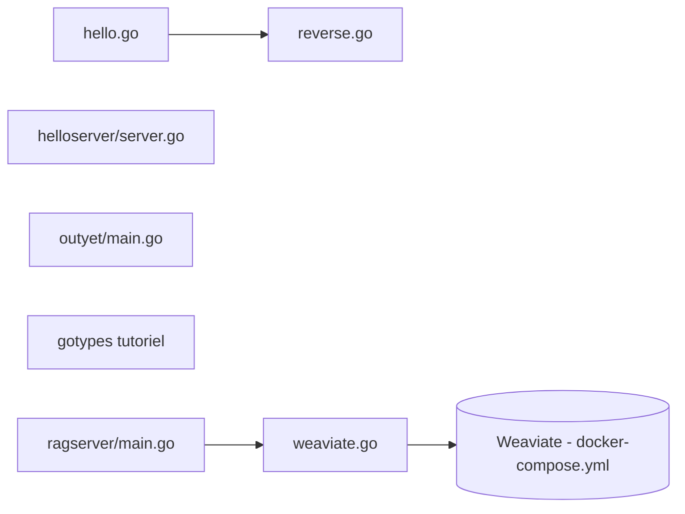

# golang/example

> Collection of small official Go programs for learning the language, the standard library and the tools.

## The problem
Learning Go requires short, correct examples written by the language team rather than scattered tutorials.

## What it actually does
The repository gathers independent examples: `hello` and its `reverse` library, `helloserver`, `outyet` (server with templates, `expvar`, synchronisation), `template`, `appengine-hello`, a `gotypes` tutorial on `go/types`, a `slog` handler guide. The code described adds RAG servers (`ragserver`, Genkit and LangChainGo variants) that rely on Weaviate, launched via docker-compose for tests.

## How it is wired


## Trying it
```bash
git clone https://go.googlesource.com/example
cd example
cd hello
go build
./hello -help
cd helloserver
go run .
```

## Cost and gotchas
Free. For the RAG servers, Weaviate is required for integration; the README does not document these servers (they only appear in the code architecture).

## What it is not
Not a framework nor a dependency to import: each folder is a teaching example. The steps of `slog-handler-guide` are learning stages, not code to reuse as is.

## Alternatives
No alternative named in the README.

## For you
Worth watching: useful as a reference if you are learning Go, but nothing specific to data/AI, apart from the undocumented RAG examples.
