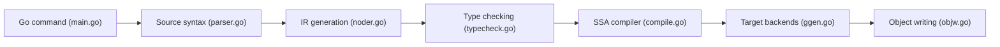

# golang/go

> The Go programming language, its compiler, tools and standard library, for developers.

## The problem
Writing simple, reliable services with standalone binaries, without depending on an external runtime.

## What it actually does
The repository contains the `go` command (toolchain selection, module queries), the compiler (parser, type checking, IR, SSA, per-target backends, object writing), the assembler and the standard library (HTTP, HTTP/2, RPC, tar/zip archives). The README is very short: minimal sheet.

## How it is wired

## Trying it
No command in the README: download the binaries from https://go.dev/dl/, then follow the instructions at https://go.dev/doc/install.

## Cost and gotchas
Free. The canonical repository is go.googlesource.com; GitHub is only a mirror. The number of open issues is very high (over 10,000).

## What it is not
It is not a project to which you contribute through the usual GitHub route, since the mirror is not the source. The README says nothing about governance.

## Alternatives
No alternative named in the README.

## For you
Watch: Go is common in cloud and MLOps tooling (frp, several servers), but this repository is for building the language, not for your daily work.
