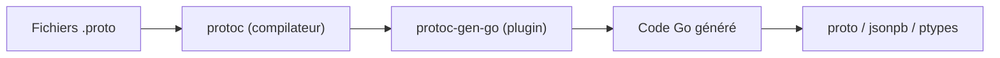

# golang/protobuf

> Go module for handling Protocol Buffers messages and generating Go code with `protoc-gen-go`.

## The problem
Reading, writing and converting protobuf messages in Go requires a runtime library and a code generator.

## What it actually does
Packages `proto` (cloning, merging, equality, binary and text serialization), `jsonpb` (JSON), `ptypes` (well-known types: Any, Timestamp, Duration…) and the `protoc-gen-go` binary, a plugin for the `protoc` compiler. The README spells out what may break: security, unspecified behavior, specification changes, bugs, generated additions, internal code.

## How it is wired

## Trying it
No command documented in the README: it lists the packages and the compatibility rules.

## Cost and gotchas
Free. Compatibility breaks outside reserved areas are announced six months in advance on the `protobuf@googlegroups.com` list. A bug report must state the module version and the protobuf toolchain version.

## What it is not
Not a protobuf compiler: `protoc` is still required. The README does not compare it with other modules.

## Alternatives
No alternative named in the README.

## For you
Ignore unless you write Go: for data/AI Python, the protobuf layer is provided by other libraries.
