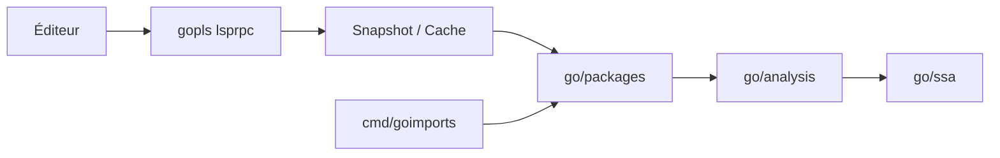

# golang/tools

> The golang.org/x/tools module: Go static analysis, command-line tools and the gopls server.

## The problem
Analyzing, formatting and tooling Go code (imports, call graphs, LSP) requires shared building blocks.

## What it actually does
Provides `goimports`, `callgraph`, `stringer`, `digraph`, `toolstash`, and the packages `go/ssa`, `go/packages`, `go/analysis`, `go/callgraph`, `go/cfg`. The `gopls` module is the LSP server for VS Code, Vim, etc.

## How it is wired


## Trying it
```bash
go install golang.org/x/tools/cmd/goimports@latest
```

## Cost and gotchas
Free. Gopls has internal telemetry (`gopls/internal/telemetry` folder), not detailed in the README.

## What it is not
Not a tool for Python or AI; it is Go tooling.

## Alternatives
No alternative named in the README.

## For you
Ignore unless you write Go: nothing useful for a data/AI/MLOps profile outside that language.
