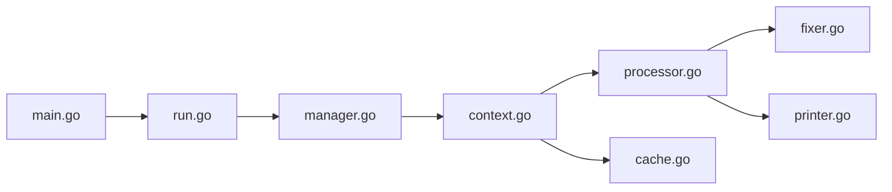

# golangci/golangci-lint

> Parallel Go linters runner with caching and YAML configuration, for Go developers.

## The problem
Running dozens of Go linters separately is slow and hard to configure consistently.

## What it actually does
The `run` command loads the configuration, selects linters, analyzes packages in parallel (with cache), processes the issues found and prints the results in the chosen format. Over a hundred linters, automatic fixes, a formatting command and configuration migration. Integrated with the main IDEs. The provided README is very short: the docs are at golangci-lint.run.

## How it is wired


## Trying it
```bash
# Aucune commande dans le README fourni (il renvoie à la page d'installation en ligne).
```

## Cost and gotchas
Free. GPL-3.0 license: no consequence for a tool you run, to be checked if you embed it.

## What it is not
Not a type checker or a tester: it aggregates linters.

## Alternatives
No alternative named in the README.

## For you
Adopt only if you write Go (MLOps tools, Kubernetes operators); otherwise irrelevant.
