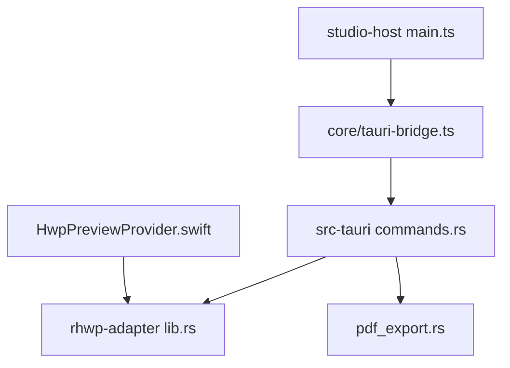

# golbin/hop

> Open source desktop application to open and edit Korean HWP/HWPX documents.

## The problem
The HWP format (Korean word processor) is hard to open outside Hancom on macOS or Linux.

## What it actually does
A thin Tauri layer on top of the rhwp engine: open HWP/HWPX, save, export to PDF, print, drag and drop, file association, multiple windows. A macOS QuickLook extension uses the same adapter.

## How it is wired


## Trying it
```bash
brew install hop
yay -S hop-openhwp-bin
```

## Cost and gotchas
Free. The Windows build is unsigned: SmartScreen warning. On Linux, the AppImage may interfere with the Korean IME under Wayland.

## What it is not
Not a rendering engine: everything relies on rhwp. The README is in Korean.

## Alternatives
- rhwp: the HWP engine HOP builds on.

## For you
Ignore: unless you process Korean HWP documents; no link with data/AI.
