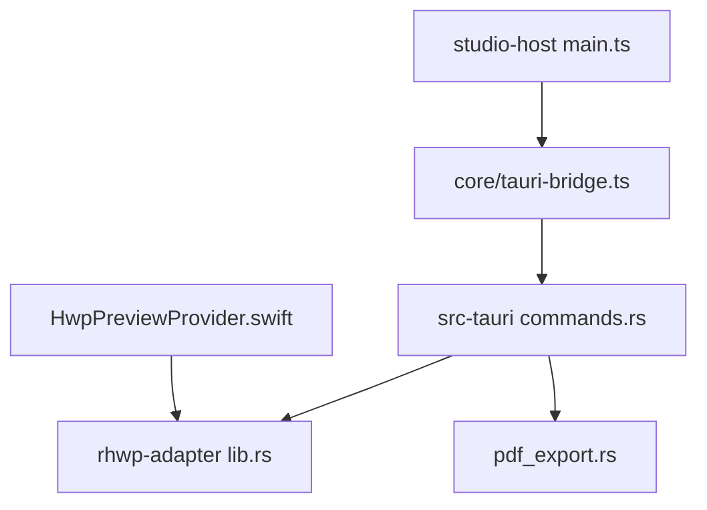

# golbin/hop

> Application de bureau open source pour ouvrir et éditer les documents HWP/HWPX coréens.

## Le problème
Le format HWP (traitement de texte coréen) est difficile à ouvrir hors de Hancom sur macOS ou Linux.

## Ce que ça fait vraiment
Fine couche Tauri au-dessus du moteur rhwp : ouvrir HWP/HWPX, enregistrer, exporter en PDF, imprimer, glisser-déposer, association de fichiers, plusieurs fenêtres. Une extension QuickLook macOS utilise le même adaptateur.

## Comment c'est branché


## Essayer
```bash
brew install hop
yay -S hop-openhwp-bin
```

## Coût et pièges
Gratuit. Build Windows non signé : avertissement SmartScreen. Sous Linux, l'AppImage peut gêner l'IME coréen sous Wayland.

## Ce que ce n'est pas
Pas un moteur de rendu : tout repose sur rhwp. Le README est en coréen.

## Alternatives
- rhwp : le moteur HWP sur lequel HOP s'appuie.

## Pour toi
Ignorer : sauf si tu traites des documents HWP coréens ; aucun lien avec data/IA.

