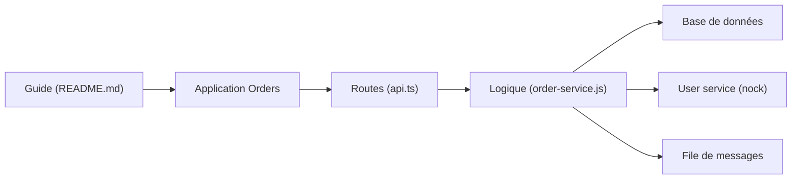

# goldbergyoni/nodejs-testing-best-practices

> Guide of more than 50 best practices for component testing of Node.js backends, with a sample application.

## The problem
Teams write either too many brittle unit tests or slow E2E tests; few realistic intermediate approaches are documented.

## What it actually does
The README is organized in eight sections: strategy (start with component tests, a few E2E), infrastructure (real database in docker-compose, schema via migrations), in-process test server, anatomy of tests, integrations (HTTP interception with nock, network chaos), data, message queues (fake MQ, idempotency, poisoned messages) and mocks. An "Orders" application and recipes (Nest.js, Mocha, OpenAPI) illustrate it.

## How it is wired


## Trying it
```bash
# Aucune commande d'installation dans le README.
# Extraits : dockerCompose.upAll() en globalSetup Jest,
# nock.disableNetConnect() pour bloquer les appels sortants.
```

## Cost and gotchas
Free; Docker to reproduce the test database. Several examples are marked "TODO", some sections are incomplete and the README ends with stray text. No license declared. The author's paid courses are promoted.

## What it is not
Not a framework nor a testing library. Aimed at Node.js backends: no guidance for Python or ML.

## Alternatives
Not documented in the README (it points to the author's sister guide on unit testing, without naming it).

## For you
The principles (component tests, real database, message queue fakes) transpose to an inference service; worth reading, but not to adopt as is if you don't write Node.
