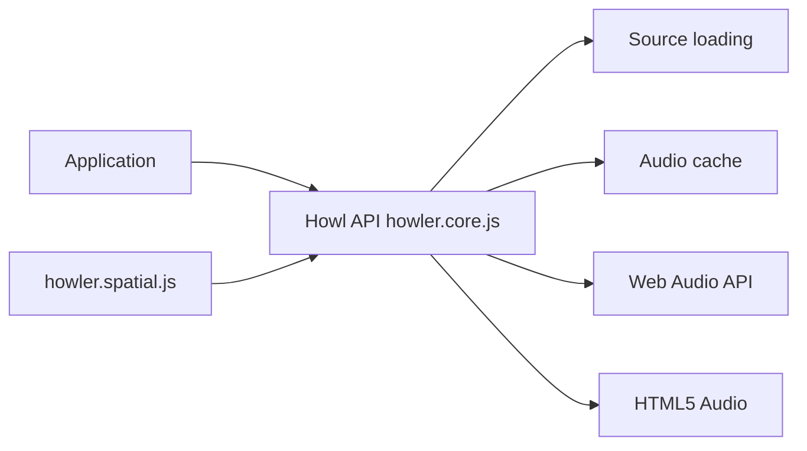

# goldfire/howler.js

> Audio library for the web, with a single API over Web Audio and HTML5 Audio, for front-end developers.

## The problem
Browsers handle audio unevenly: codecs, mobile locking, caching.

## What it actually does
Loads and plays sounds with Web Audio by default and an HTML5 Audio fallback. Handles audio sprites, fades, speed, playback position, sound groups and automatic unlocking on mobile. The spatial plugin adds stereo panning and 3D sound. No dependencies; about 7 KB gzipped according to the README.

## How it is wired


## Trying it
```bash
npm install howler
```
```js
var sound = new Howl({ src: ['sound.webm', 'sound.mp3'] });
sound.play();
```

## Cost and gotchas
Free. On mobile, audio stays locked until there has been some interaction. Sources are tried in order: put webm before mp3. Last push in November 2025.

## What it is not
Not an audio processing or synthesis tool: it is a player. A Howl holds only a single audio file.

## Alternatives
No alternative named in the README.

## For you
Watch: useful for adding sounds to a web demo; no value for audio analysis or voice AI.
