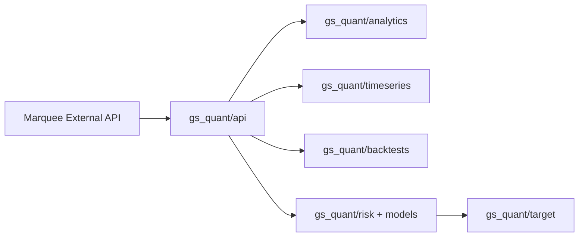

# goldmansachs/gs-quant

> Goldman Sachs's Python toolkit for quantitative finance, for institutional-client quants.

## The problem
Developing trading and derivatives risk-management strategies requires analysis tools and access to market data.

## What it actually does
`gs_quant` package with modules for API (sessions, assets), analytics, time series, backtests, markets, instruments, risk, models and reports. API calls go through Goldman Sachs's Marquee platform, which requires a client ID and secret reserved for institutional clients. The README says nothing more.

## How it is wired


## Trying it
```bash
pip install gs-quant
```

## Cost and gotchas
Python 3.9 or later. The APIs require a client ID and secret obtained from Goldman Sachs's sales team: without a client account, most of it does not work. The README states 3.9 and the code 3.8: a version inconsistency.

## What it is not
Not a standalone tool and not open to everyone: it is a client for a platform reserved for institutional clients.

## Alternatives
No alternative cited in the README.

## For you
Worth watching: relevant only if your organization is a Goldman Sachs client; otherwise unusable without Marquee access.
