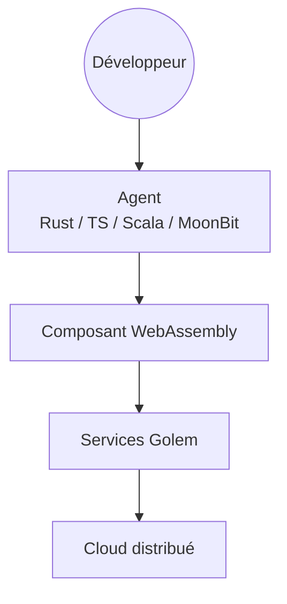

# golemcloud/golem

> Services to run WebAssembly components and agents in a distributed cloud.

## The problem
Not documented in the README: it does not describe the problem solved.

## What it actually does
The README announces a set of services that run WebAssembly components in a distributed cloud environment, and the creation of agents in Rust, TypeScript, Scala and MoonBit. Details are deferred to the external documentation and the contribution guide. The `docs/` folder contains the source of the learn.golem.cloud site (Next.js / Nextra).

## How it is wired
Simplified diagram based on the sheet, no diagram provided.

## Trying it
No command documented in the README: see the Golem Developer Documentation and the contribution guide.

## Cost and gotchas
Not documented. A Golem Cloud offering is mentioned, with no pricing. License present but not identified by GitHub: read it before any use.

## What it is not
Not usable on the README alone: there is no installation or example. The repository is not a simple application.

## Alternatives
No alternative named in the README.

## For you
Worth watching: running agents on WebAssembly may interest an AI profile, but the README is too short to judge, and the license needs checking.
