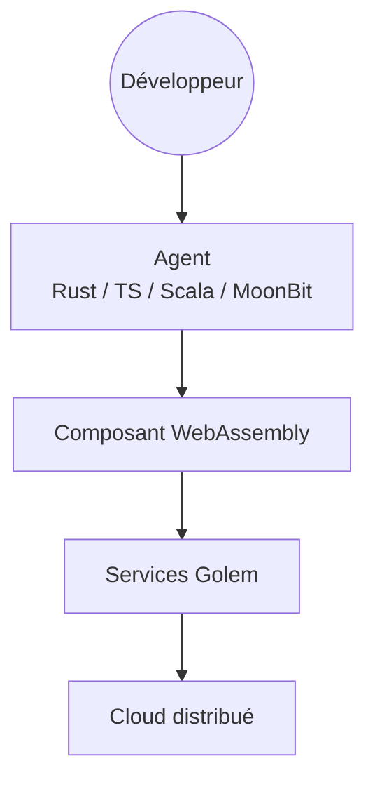

# golemcloud/golem

> Services pour exécuter des composants WebAssembly et des agents dans un cloud distribué.

## Le problème
Non documenté dans le README : il ne décrit pas le problème résolu.

## Ce que ça fait vraiment
Le README annonce un ensemble de services qui exécutent des composants WebAssembly dans un environnement cloud distribué, et la création d'agents en Rust, TypeScript, Scala et MoonBit. Le détail est renvoyé à la documentation externe et au guide de contribution. Le dossier `docs/` contient la source du site learn.golem.cloud (Next.js / Nextra).

## Comment c'est branché
Schéma simplifié d'après la fiche, sans diagramme fourni.

## Essayer
Aucune commande documentée dans le README : voir Golem Developer Documentation et le guide de contribution.

## Coût et pièges
Non documenté. Une offre Golem Cloud est mentionnée, sans tarif. Licence présente mais non identifiée par GitHub : à lire avant tout usage.

## Ce que ce n'est pas
Ce n'est pas utilisable sur la seule foi du README : il n'y a ni installation ni exemple. Le dépôt n'est pas une application simple.

## Alternatives
Aucune alternative nommée dans le README.

## Pour toi
À surveiller : l'exécution d'agents sur WebAssembly peut intéresser un profil IA, mais le README est trop court pour juger, et la licence est à vérifier.

