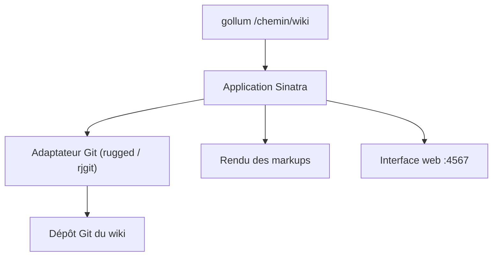

# gollum/gollum

> Simple Git-based wiki whose pages are editable text files, for people documenting as a team.

## The problem
Classic wikis lock content inside a database; you want versioned pages, editable in your own editor.

## What it actually does
A Git repository becomes a wiki served on port 4567. Pages are editable with any editor or through the web interface, with history and rollback. It handles several formats (Markdown, RDoc, and others via gems), Mermaid and PlantUML diagrams, KaTeX or MathJax formulas, BibTeX, CriticMarkup and an RSS feed. It aims for compatibility with GitHub and GitLab wikis.

## How it is wired


## Trying it
```bash
gem install gollum
gollum /path/to/wiki
bundle install
bundle exec bin/gollum
java -jar gollum.war -S gollum <arguments>
```

## Cost and gotchas
Free. You need Ruby (or JRuby, the only choice on Windows), or Java for the `.war`. By default it listens on 0.0.0.0: use `--host 127.0.0.1` for a personal wiki.

## What it is not
Not a cloud note-taking tool: no full built-in authentication, only an example with CAS. RST or Pod rendering requires Python or Perl.

## Alternatives
- No alternative named in the README.

## For you
Watch: handy for a project wiki in Git, but a Markdown docs repository rendered by a site generator is often enough.
