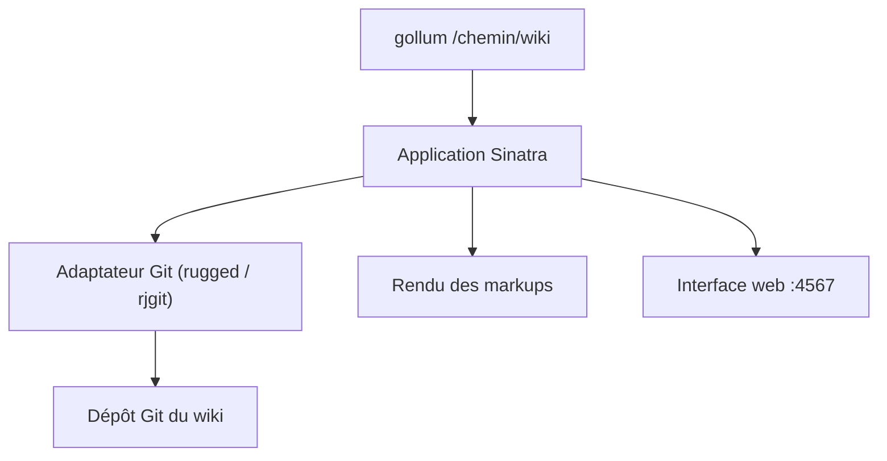

# gollum/gollum

> Wiki simple bâti sur Git, dont les pages sont des fichiers texte éditables, pour qui documente en équipe.

## Le problème
Les wikis classiques enferment le contenu dans une base ; on veut des pages versionnées, éditables dans son éditeur.

## Ce que ça fait vraiment
Un dépôt Git devient un wiki servi sur le port 4567. Les pages sont éditables avec n'importe quel éditeur ou via l'interface web, avec historique et retour arrière. Il gère plusieurs formats (Markdown, RDoc, et d'autres via gems), les diagrammes Mermaid et PlantUML, les formules KaTeX ou MathJax, BibTeX, CriticMarkup et un flux RSS. Il vise la compatibilité avec les wikis GitHub et GitLab.

## Comment c'est branché


## Essayer
```bash
gem install gollum
gollum /path/to/wiki
bundle install
bundle exec bin/gollum
java -jar gollum.war -S gollum <arguments>
```

## Coût et pièges
Gratuit. Il faut Ruby (ou JRuby, seul choix sous Windows), ou Java pour le `.war`. Par défaut l'écoute se fait sur 0.0.0.0 : utilise `--host 127.0.0.1` pour un wiki personnel.

## Ce que ce n'est pas
Pas un outil de prise de notes cloud : pas d'authentification complète intégrée, seulement un exemple avec CAS. Les rendus RST ou Pod demandent Python ou Perl.

## Alternatives
- Aucune alternative nommée dans le README.

## Pour toi
À surveiller : pratique pour un wiki de projet en Git, mais un dépôt de docs Markdown rendu par un générateur de site suffit souvent.

