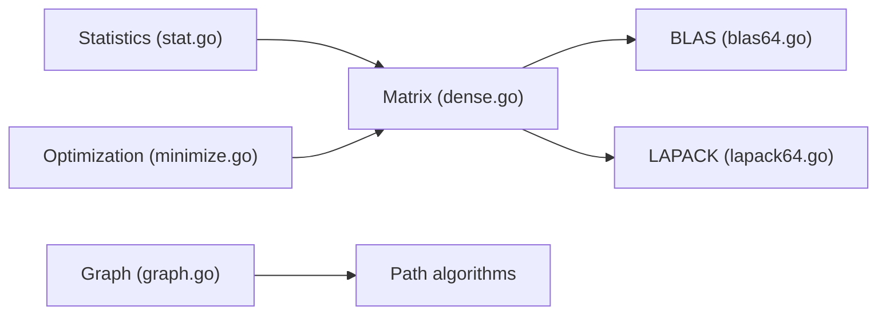

# gonum/gonum

> Numerical and scientific computing suite in Go: linear algebra, graphs, statistics, optimization.

## The problem
Go has no native equivalent of NumPy/SciPy for scientific computing.

## What it actually does
Packages in pure Go (with a bit of assembly): BLAS/LAPACK and dense matrices, graphs (algorithms, formats), statistics and distributions, optimization, FFT, numerical integration, finite differences, interpolation, special functions. Build tags (`safe`, `noasm`, `bounds`). Releases every six months, aligned with Go.

## How it is wired


## Trying it
```bash
go get -u gonum.org/v1/gonum/...
```

## Cost and gotchas
Free. Versions still in v0.x. 256 open issues. Minimal README: the docs are elsewhere.

## What it is not
No deep learning or dataframe ecosystem comparable to Python's.

## Alternatives
None named in the README.

## For you
Watch: relevant only for compute services in Go; in Python, stay on NumPy/SciPy.
