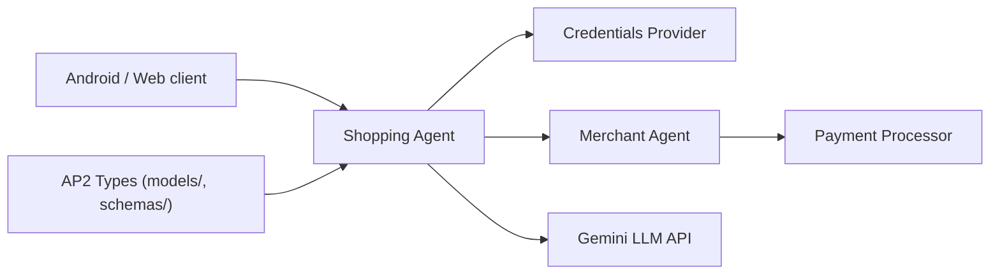

# google-agentic-commerce/AP2

> Examples and SDK of a payment protocol for agents, with Python, Go and Android scenarios.

## The problem
When an agent buys on behalf of a user, standard objects are needed to prove the mandate, the cart and the payment method.

## What it actually does
A repository of examples and specification: a Python SDK (`code/sdk/python/ap2/`, Pydantic models and JSON schemas), runnable scenarios (`run.sh`), and separate roles: shopping agent, merchant agent, credentials provider, payment processor. The samples use ADK and a Gemini model, but the protocol is not tied to them. The PyPI package is not published yet.

## How it is wired


## Trying it
```bash
export GOOGLE_API_KEY='your_key'
bash code/samples/python/scenarios/a2a/human-present/cards/run.sh
uv pip install git+https://github.com/google-agentic-commerce/AP2.git@main
```

## Cost and gotchas
A Google AI Studio or Vertex AI key is required, so calls are billable. These are demonstrations, not a real payment system.

## What it is not
Not a payment product or a gateway: it describes and illustrates a protocol. The README mentions no certification.

## Alternatives
Not documented in the README.

## For you
Watch: worth reading if you design agents that act with money; too early (SDK not published) to use it.
