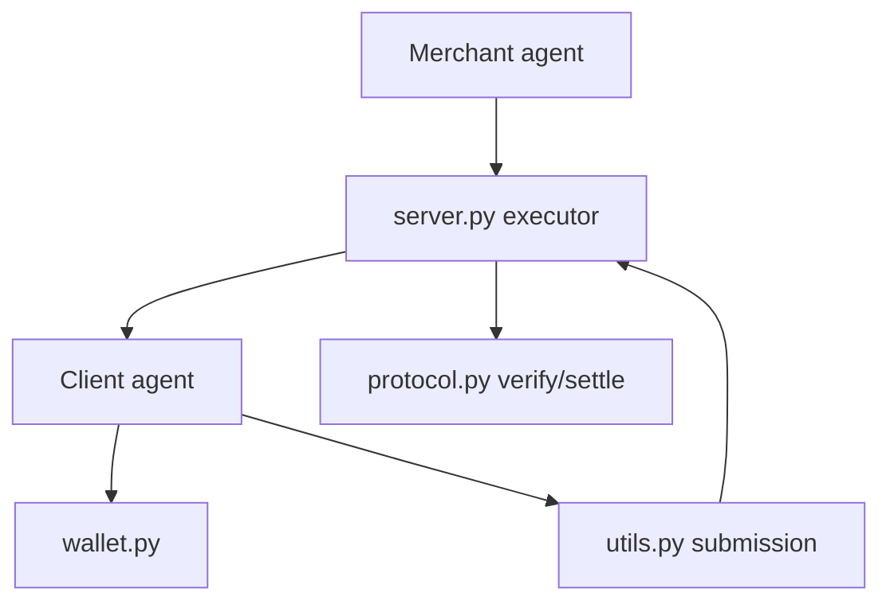

# google-agentic-commerce/a2a-x402

> Extension of the A2A protocol so that agents can get paid in crypto, for agent developers.

## The problem
An agent offering a service has no standard way to bill for it and be paid online by another agent.

## What it actually does
- v0.1 specification and `x402_a2a` Python library, with examples; other languages planned in the directory tree.
- Flow: `payment-required`, `payment-submitted`, `payment-completed`.
- The merchant verifies and settles the payment on-chain before delivering the service.
- "Functional core, imperative shell" architecture: core protocol and executors that automate the flow.

## How it is wired

## Trying it
No command at the root level: the README points to the READMEs of `python/x402_a2a` and `examples/`, not provided here.

## Cost and gotchas
Assumes a wallet, a blockchain network and the underlying x402 protocol. On-chain fees are not detailed.

## What it is not
Not a product ready to collect payments: spec versioned 0.1 and experimental payment schemes. Nothing about key security in the README.

## Alternatives
- AP2 (Agent Payments Protocol): a neighboring protocol cited in the README.

## For you
Keep an eye on it: agent-to-agent payment is a topic to follow, but too young and far from common data / MLOps use.
