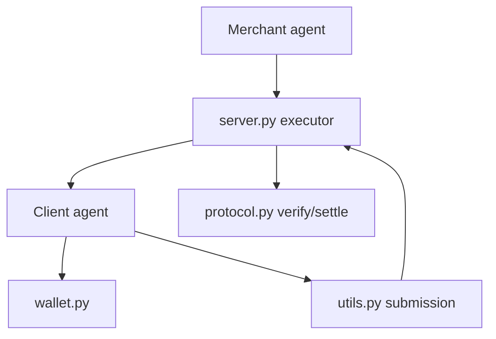

# google-agentic-commerce/a2a-x402

> Extension du protocole A2A pour que des agents se fassent payer en crypto, pour développeurs d'agents.

## Le problème
Un agent qui offre un service n'a pas de moyen standard de le facturer et d'être payé en ligne par un autre agent.

## Ce que ça fait vraiment
- Spécification v0.1 et bibliothèque Python `x402_a2a`, avec exemples ; autres langages prévus dans l'arborescence.
- Flux : `payment-required`, `payment-submitted`, `payment-completed`.
- Le marchand vérifie et règle le paiement on-chain avant de livrer le service.
- Architecture « functional core, imperative shell » : protocole cœur et executors qui automatisent le flux.

## Comment c'est branché

## Essayer
Aucune commande au niveau racine : le README renvoie aux README de `python/x402_a2a` et de `examples/`, non fournis ici.

## Coût et pièges
Suppose un portefeuille, un réseau blockchain et le protocole x402 sous-jacent. Les frais on-chain ne sont pas détaillés.

## Ce que ce n'est pas
Pas un produit prêt à encaisser : spec versionnée 0.1 et schémas de paiement expérimentaux. Rien sur la sécurité des clés dans le README.

## Alternatives
- AP2 (Agent Payments Protocol) : protocole voisin cité dans le README.

## Pour toi
À surveiller : sujet de paiement entre agents à suivre, mais trop jeune et éloigné d'un usage data / MLOps courant.

