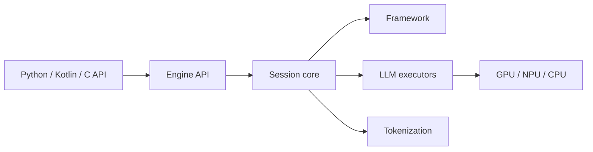

# google-ai-edge/LiteRT-LM

> Google's orchestration layer for running LLMs on device via LiteRT, from mobile to Raspberry Pi.

## The problem
Running a multimodal LLM on a phone, browser or embedded board requires a runtime suited to each accelerator.

## What it actually does
Native C++ core with engine, sessions, tokenization, constrained decoding, function calls, LoRA and KV cache. Text, vision and audio executors on CPU, GPU or NPU. Python, Kotlin, C, Swift and Web interfaces; `litert-lm` CLI with an OpenAI-compatible server, including `/v1/embeddings`. `.litertlm` formats. Used in Chrome, Chromebook Plus and Pixel Watch.

## How it is wired


## Trying it
```bash
uv tool install litert-lm
litert-lm run \
  --from-huggingface-repo=google/gemma-3n-E2B-it-litert-lm \
  gemma-3n-E2B-it-int4 \
  --prompt="What is the capital of France?"
```

## Cost and gotchas
Free. Models are downloaded from Hugging Face. Building goes through Bazel (the README points to a guide). 719 open issues. README truncated after "Build From Source".

## What it is not
Not a model host: you need models converted to the LiteRT-LM format. The README says "production-ready" but gives no performance figures.

## Alternatives
None named in the README.

## For you
Worth watching: relevant if you deploy small models at the edge (Gemma, Qwen), less so if you stay server-side on GPU.
