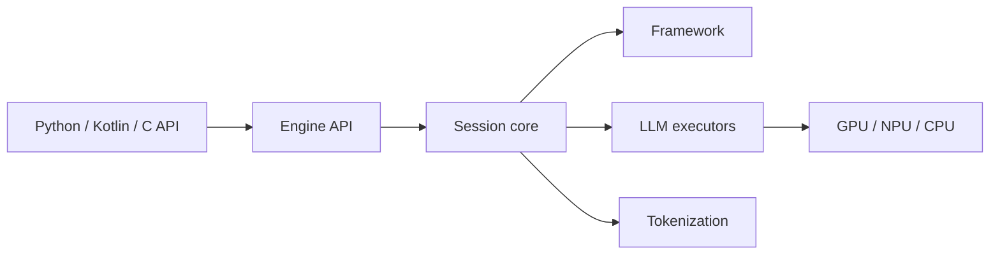

# google-ai-edge/LiteRT-LM

> Couche d'orchestration de Google pour exécuter des LLM sur appareil via LiteRT, du mobile au Raspberry Pi.

## Le problème
Faire tourner un LLM multimodal sur téléphone, navigateur ou carte embarquée exige un runtime adapté à chaque accélérateur.

## Ce que ça fait vraiment
Noyau natif en C++ avec moteur, sessions, tokenisation, décodage contraint, appels de fonctions, LoRA et cache KV. Exécuteurs texte, vision et audio sur CPU, GPU ou NPU. Interfaces Python, Kotlin, C, Swift et Web ; CLI `litert-lm` avec serveur compatible OpenAI, incluant `/v1/embeddings`. Formats `.litertlm`. Utilisé dans Chrome, Chromebook Plus et Pixel Watch.

## Comment c'est branché


## Essayer
```bash
uv tool install litert-lm
litert-lm run \
  --from-huggingface-repo=google/gemma-3n-E2B-it-litert-lm \
  gemma-3n-E2B-it-int4 \
  --prompt="What is the capital of France?"
```

## Coût et pièges
Gratuit. Téléchargement de modèles depuis Hugging Face. La compilation passe par Bazel (le README renvoie à un guide). 719 issues ouvertes. README tronqué après « Build From Source ».

## Ce que ce n'est pas
Pas un hébergeur de modèles : il faut des modèles convertis au format LiteRT-LM. Le README parle de « production-ready » mais ne chiffre aucune performance.

## Alternatives
Aucune nommée dans le README.

## Pour toi
À surveiller : pertinent si tu déploies des petits modèles en edge (Gemma, Qwen), moins si tu restes côté serveur GPU.

