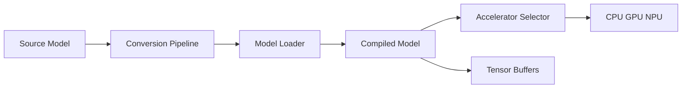

# google-ai-edge/LiteRT

> Google's runtime for running ML and GenAI models on mobile, web and embedded devices.

## The problem
Deploying a model on a mobile or edge device, with GPU/NPU acceleration, requires a runtime adapted to each chip.

## What it actually does
Successor to TensorFlow Lite: the "Compiled Model" API loads a converted model, picks CPU, GPU or NPU, and returns tensors (C++, Python, Kotlin, JavaScript). PyTorch converter, quantisation, LiteRT-LM for LLMs, LiteRT.js for the browser, Qualcomm and Samsung integrations.

## How it is wired


## Trying it
```bash
uv venv --clear --python=3.13 --seed
source .venv/bin/activate
uv pip install litert-cli-nightly
litert --help
```

## Cost and gotchas
Python 3.13 for the CLI. Building from source via Docker. NPU support depends on the chip manufacturer.

## What it is not
Not the TensorFlow Lite `Interpreter` API, which is declared in maintenance. Speed gains are not quantified here.

## Alternatives
- XNNPACK: CPU operator library used underneath.
- MediaPipe: framework of ML solutions on streams.

## For you
Adopt if you deploy models at the edge: it is Google's official path, with recent activity.
