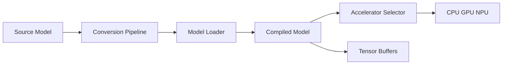

# google-ai-edge/LiteRT

> Runtime de Google pour exécuter modèles ML et GenAI sur appareils mobiles, web et embarqués.

## Le problème
Déployer un modèle sur mobile ou périphérique, avec accélération GPU/NPU, demande un runtime adapté à chaque puce.

## Ce que ça fait vraiment
Successeur de TensorFlow Lite : l'API « Compiled Model » charge un modèle converti, choisit CPU, GPU ou NPU, et renvoie des tenseurs (C++, Python, Kotlin, JavaScript). Convertisseur PyTorch, quantification, LiteRT-LM pour les LLM, LiteRT.js pour le navigateur, intégrations Qualcomm et Samsung.

## Comment c'est branché


## Essayer
```bash
uv venv --clear --python=3.13 --seed
source .venv/bin/activate
uv pip install litert-cli-nightly
litert --help
```

## Coût et pièges
Python 3.13 pour le CLI. Compilation depuis les sources via Docker. Support NPU dépend du fabricant de la puce.

## Ce que ce n'est pas
Pas l'API `Interpreter` de TensorFlow Lite, déclarée en maintenance. Les gains de vitesse ne sont pas chiffrés ici.

## Alternatives
- XNNPACK : bibliothèque d'opérateurs CPU utilisée en dessous.
- MediaPipe : framework de solutions ML sur flux.

## Pour toi
À adopter si tu déploies des modèles à la périphérie : c'est la voie officielle de Google, avec de l'activité récente.

