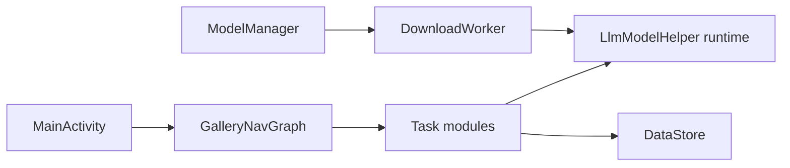

# google-ai-edge/gallery

> Mobile app to test, compare and benchmark open generative models running on the phone.

## The problem
Evaluating an on-device LLM on your own hardware means compiling code or sending data to the cloud.

## What it actually does
Android (12+) and iOS (17+) app, with a macOS version. Downloads models (Hugging Face) and runs them locally via LiteRT: chat with thinking mode, Agent Skills (Wikipedia, maps), Ask Image, Audio Scribe, Prompt Lab, media search, Mobile Actions and the Tiny Garden mini-game. Per-model benchmark on your device. Versioned allowlists for models and skills.

## How it is wired

## Trying it
No command in the README: install from Google Play or the App Store, or the APK from the latest release; building is described in the development notes.

## Cost and gotchas
Free. Inference is local, but downloading models requires network and storage space. Performance depends on the device. Announced as an experimental beta.

## What it is not
Not an inference library nor a service: it is a demo app. Thinking Mode only works with compatible models (Gemma 4 family).

## Alternatives
No alternative named in the README.

## For you
Worth watching: handy for gauging an on-device model on a real phone before deciding to integrate it; it is not a production component.
