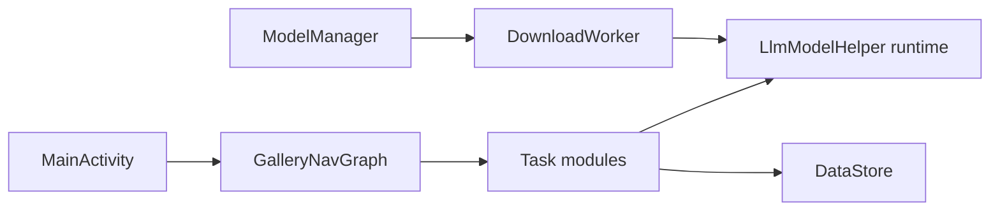

# google-ai-edge/gallery

> Application mobile pour tester, comparer et benchmarker des modèles génératifs ouverts exécutés sur le téléphone.

## Le problème
Évaluer un LLM embarqué sur ton propre matériel suppose de compiler du code ou d'envoyer des données dans le cloud.

## Ce que ça fait vraiment
Application Android (12+) et iOS (17+), avec une version macOS. Télécharge des modèles (Hugging Face), les exécute localement via LiteRT : chat avec mode réflexion, Agent Skills (Wikipedia, cartes), Ask Image, Audio Scribe, Prompt Lab, recherche de médias, Mobile Actions et mini-jeu Tiny Garden. Benchmark par modèle sur ton appareil. Listes d'autorisation versionnées pour modèles et skills.

## Comment c'est branché

## Essayer
Aucune commande dans le README : installer depuis Google Play ou l'App Store, ou l'APK de la dernière release ; la compilation est décrite dans les notes de développement.

## Coût et pièges
Gratuit. L'inférence est locale, mais le téléchargement des modèles demande du réseau et de l'espace. Les performances dépendent de l'appareil. Version annoncée comme bêta expérimentale.

## Ce que ce n'est pas
Pas une bibliothèque d'inférence ni un service : c'est une application de démonstration. Thinking Mode ne marche qu'avec des modèles compatibles (famille Gemma 4).

## Alternatives
Aucune alternative nommée dans le README.

## Pour toi
À surveiller : pratique pour jauger sur un vrai téléphone un modèle embarqué avant de décider de l'intégrer ; ce n'est pas un composant de production.

