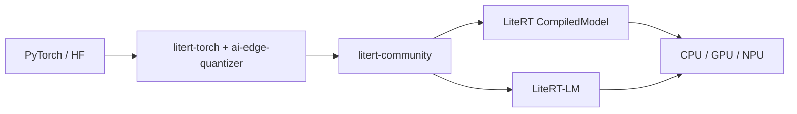

# google-ai-edge/litert-samples

> Official samples, conversion recipes and benchmarks for running models on-device with LiteRT.

## The problem
Going from a PyTorch or Hugging Face checkpoint to a model running on a phone, browser or embedded board requires many scattered pieces.

## What it actually does
Repository gathering sample applications (Android, iOS, Flutter, Web, Raspberry Pi), reproducible conversion recipes under `models/`, a benchmark rig on real phones and nine `SKILL.md` playbooks for coding agents. Ready-to-use models are on Hugging Face `litert-community`.

## How it is wired


## Trying it
```bash
pip install litert-cli-nightly
litert download litert-community/efficientnet_b1
litert benchmark efficientnet_b1.tflite --gpu
```

## Cost and gotchas
Free; the CLI is a "nightly" package. The benchmark on real phones goes through Google Cloud Developer Device Platform. Some samples require a specific chip (Snapdragon, Tensor, Intel NPU).

## What it is not
Not a framework: the runtime is in LiteRT and LiteRT-LM, neighboring repositories. The legacy Interpreters are kept only for migration.

## Alternatives
- google-ai-edge/LiteRT: the runtime itself.
- google-ai-edge/LiteRT-LM: on-device LLM engine.
- google-ai-edge/gallery: demo application to try the models.

## For you
Adopt if you deploy embedded AI: it is the official reference for converting, quantizing and measuring a model on-device.
