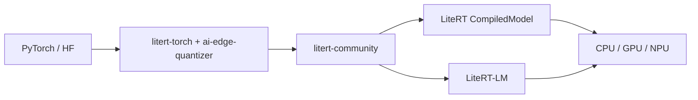

# google-ai-edge/litert-samples

> Exemples officiels, recettes de conversion et benchmarks pour faire tourner des modèles sur appareil avec LiteRT.

## Le problème
Passer d'un checkpoint PyTorch ou Hugging Face à un modèle exécuté sur téléphone, navigateur ou carte embarquée demande beaucoup de pièces dispersées.

## Ce que ça fait vraiment
Dépôt regroupant des applications d'exemple (Android, iOS, Flutter, Web, Raspberry Pi), des recettes de conversion reproductibles sous `models/`, un banc d'essai sur vrais téléphones et neuf playbooks `SKILL.md` pour agents de code. Les modèles prêts à l'emploi sont sur Hugging Face `litert-community`.

## Comment c'est branché


## Essayer
```bash
pip install litert-cli-nightly
litert download litert-community/efficientnet_b1
litert benchmark efficientnet_b1.tflite --gpu
```

## Coût et pièges
Gratuit ; le CLI est un paquet « nightly ». Le benchmark sur vrais téléphones passe par Google Cloud Developer Device Platform. Certains exemples exigent une puce précise (Snapdragon, Tensor, Intel NPU).

## Ce que ce n'est pas
Pas un framework : le runtime est dans LiteRT et LiteRT-LM, dépôts voisins. Les Interpreter hérités ne sont gardés que pour migration.

## Alternatives
- google-ai-edge/LiteRT : le runtime lui-même.
- google-ai-edge/LiteRT-LM : moteur LLM sur appareil.
- google-ai-edge/gallery : application de démonstration pour essayer les modèles.

## Pour toi
À adopter si tu déploies de l'IA embarquée : c'est la référence officielle pour convertir, quantifier et mesurer un modèle sur appareil.

