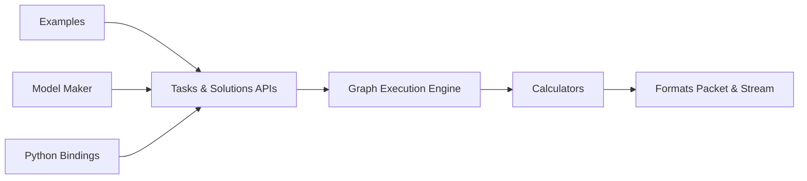

# google-ai-edge/mediapipe

> Google's on-device ML solutions and framework, for mobile, web, desktop and IoT.

## The problem
Running vision, audio, text or generative models directly on the device, across several platforms.

## What it actually does
Two levels: MediaPipe Tasks (ready-to-use APIs by domain: vision, audio, text, genai, retrieval) and MediaPipe Framework (C++ graphs of calculators processing packets). Python, Android, iOS and Web bindings; MediaPipe Studio and Model Maker to test and customize. Built with Bazel. The main documentation is on Google's site.

## How it is wired

## Trying it
No command documented in the README (it points to the per-solution and per-platform guides).

## Cost and gotchas
Free. The Tasks APIs send usage metrics to Google; you must obtain your users' consent. Input data stays on the device.

## What it is not
Not an inference server: it is for on-device use. The README points to external docs, so there is nothing here to get started.

## Alternatives
No alternative named in the README.

## For you
Worth watching if you deploy vision or audio on mobile or in the browser; off-topic for server-side inference.
