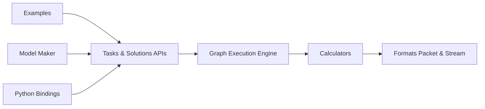

# google-ai-edge/mediapipe

> Solutions et framework de ML embarqué de Google, pour mobile, web, bureau et IoT.

## Le problème
Exécuter des modèles de vision, audio, texte ou génératifs directement sur l'appareil, sur plusieurs plateformes.

## Ce que ça fait vraiment
Deux niveaux : MediaPipe Tasks (API prêtes à l'emploi par domaine : vision, audio, texte, genai, retrieval) et MediaPipe Framework (graphes de calculateurs en C++ traitant des paquets). Liaisons Python, Android, iOS, Web ; MediaPipe Studio et Model Maker pour tester et personnaliser. Build via Bazel. La documentation principale est sur le site de Google.

## Comment c'est branché

## Essayer
Aucune commande documentée dans le README (renvoi vers les guides par solution et par plateforme).

## Coût et pièges
Gratuit. Les API Tasks envoient des métriques d'usage à Google ; tu dois obtenir le consentement de tes utilisateurs. Les données d'entrée restent sur l'appareil.

## Ce que ce n'est pas
Pas un serveur d'inférence : c'est pour l'embarqué. Le README renvoie à la doc externe, donc rien ici pour démarrer.

## Alternatives
Aucune alternative nommée dans le README.

## Pour toi
À surveiller si tu déploies de la vision ou de l'audio sur mobile ou navigateur ; hors sujet pour de l'inférence serveur.

