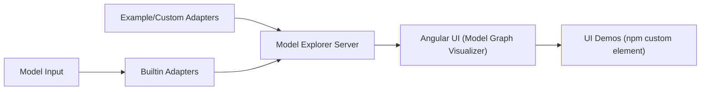

# google-ai-edge/model-explorer

> Hierarchical model graph viewer (TFLite, TF, PyTorch) to understand and debug networks.

## The problem
A model graph of thousands of operations is unreadable when flat; finding a layer or comparing identical blocks is painful.

## What it actually does
Organizes operations into nested, collapsible layers, with search, input/output highlighting, metadata overlaid on nodes, popup windows, identical blocks, GPU-accelerated rendering. Formats: TFLite, TF, TFJS, MLIR, PyTorch (Exported Program). Custom adapters add other formats. The component is also available as an npm package, and usable in Colab.

## How it is wired


## Trying it
```shell
pip install ai-edge-model-explorer
model-explorer
```

## Cost and gotchas
Free; Python required, exact version not specified in the README. The Hugging Face version only displays uploaded models. Some limitations are listed in the wiki.

## What it is not
Not a training or performance profiling tool: it shows the structure.

## Alternatives
No alternative named in the README.

## For you
Adopt: free, installable with one command, valuable for inspecting or debugging exported models.
