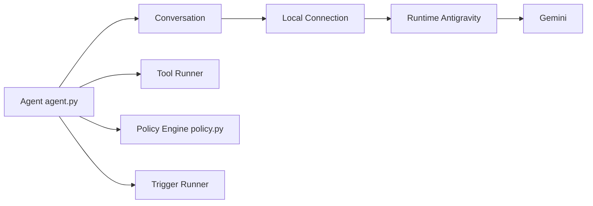

# google-antigravity/antigravity-sdk-python

> Google's Python SDK for building Gemini-backed agents, with tools, policies and triggers.

## The problem
Writing the agent loop (state, tools, guardrails, streaming) for every project is repetitive and risky.

## What it actually does
`Agent` manages the lifecycle behind an async context manager: binary discovery, Python tools, MCP servers, hooks and policies (`deny`, `allow`, `ask_user`), periodic triggers. `Conversation` keeps the history; a local connection layer talks to a runtime binary shipped in the wheel. Responses are streamed, including thoughts and tool calls. By default the agent is read-only; Vertex is supported.

## How it is wired


## Trying it
```bash
pip install google-antigravity
export GEMINI_API_KEY="your_api_key_here"
python ./examples/getting_started/hello_world.py
```

## Cost and gotchas
A Gemini key or Vertex account billed to you. The SDK requires a compiled binary published in the PyPI wheels: cloning the repo is not enough, and this binary cannot be audited here.

## What it is not
Not a provider-independent framework: it is designed for Gemini and the Antigravity runtime. The integrations are described by the README rather than by reviewed code.

## Alternatives
No alternative is cited in the README.

## For you
Worth watching: the per-tool policy system is well thought out, but the binary is closed, the project dates from April 2026 and it is tied exclusively to Google.
