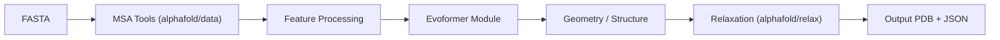

# google-deepmind/alphafold

> AlphaFold v2 inference pipeline to predict the 3D structure of proteins from their sequence.

## The problem
Getting a protein or complex structure without crystallography or cryo-EM, from the FASTA sequence alone.

## What it actually does
`run_docker.py` takes a FASTA file, searches for multiple alignments in genetic databases (BFD, MGnify, PDB70, UniRef…), produces features, runs the network (Evoformer then structure module), then relaxes by Amber minimization. Outputs: PDB models ranked by pLDDT, `features.pkl`, `timings.json`. Monomer, pTM monomer and multimer modes.

## How it is wired


## Trying it
```bash
git clone https://github.com/deepmind/alphafold.git
scripts/download_all_data.sh <DOWNLOAD_DIR>
docker build -f docker/Dockerfile -t alphafold .
pip3 install -r docker/requirements.txt
python3 docker/run_docker.py --fasta_paths=your_protein.fasta --max_template_date=2022-01-01 --data_dir=$DOWNLOAD_DIR --output_dir=/home/user/absolute_path_to_the_output_dir
```

## Cost and gotchas
Linux only, a modern NVIDIA GPU and Docker with the NVIDIA Container Toolkit. Databases: about 556 GB to download, 2.62 TB unzipped; SSD recommended. Weights under the CC BY 4.0 license, separate from the Apache-2.0 code. Prediction time explodes with size (nearly 5.2 h for 5,000 residues on an A100).

## What it is not
Not a ready-to-use service nor a protein design tool. The script is optimized for one protein at a time; no bulk inference script is provided.

## Alternatives
The README mentions simplified community-maintained versions and third-party Singularity installations, without naming them precisely.

## For you
Watch: a reference for protein folding, but heavy hardware and storage; only worth the effort if bioinformatics is part of your scope.
